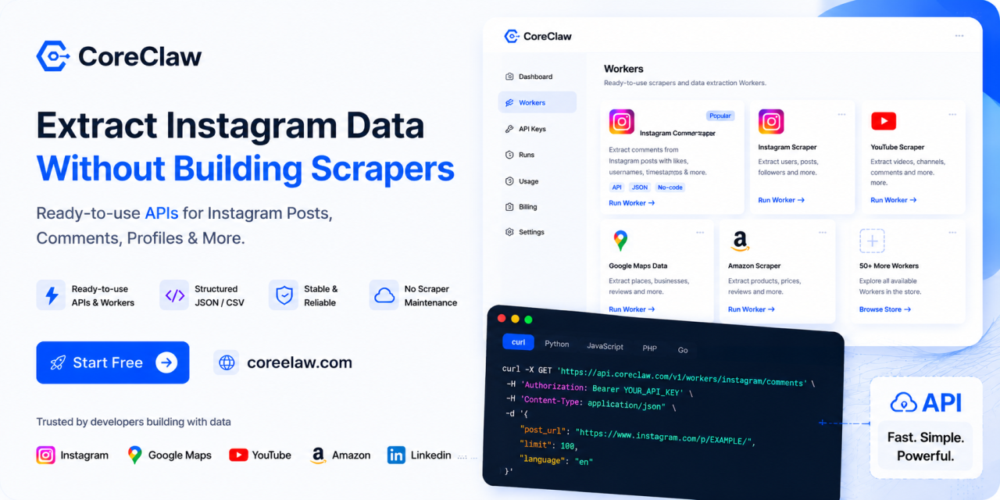

  

 

# 🚀 CoreClaw – Instagram Data API & Ready-to-use Scrapers

CoreClaw provides ready-to-use data extraction Workers and APIs for collecting structured data from Instagram and other popular platforms. Extract Instagram posts, comments, profiles, and more without building and maintaining your own scraper infrastructure.

  <a href="https://www.coreclaw.com/?utm_source=github&utm_medium=referral&utm_campaign=agi&utm_term=&utm_id=agi">
    <strong>🚀 Try CoreClaw Free →</strong>
  </a>

 

---

> I don't actively maintain this repository.
>
> 
> Why this scraper doesn't work on my side?
> 
> As I observed on the current Instagram website the website could respond with different elements or pages so this scraper might not work for some people. 

# Instagram Comments Scraper

## Installation
1. Clone:
   `git clone git@github.com:AgiMaulana/Instagram-Comments-Scraper.git`

    or `git clone https://github.com/AgiMaulana/Instagram-Comments-Scraper.git`
    
    or download the [zip](https://github.com/AgiMaulana/Instagram-Comments-Scraper/archive/master.zip)
   
3. Create Virtual Environment (Recommended)  
    - `pip install virtualenv`
    - `virtualenv .venv`  
    
4. Activate the virtual environment
    - `source .venv/bin/activate`

5. Install dependencies
    - `pip install -r requirements.txt`

6. Login
    - `username.send_keys ('USER-NAME')` change with your username
    - `password.send_keys('PASSWORD')` change with your password
       - We don't store your password

7. Run 
    - `python scraper.py post-url total-load-more-click`
   
    Change the URL with your post target.  
    For example: `python scraper.py https://www.instagram.com/p/CBHH2KjI6BW/ 5` 
 
8. Deactivate the virtual environment
    - `deactivate`

## License
This project is under the [MIT License](https://github.com/AgiMaulana/instagram-comments-scraper/blob/master/LICENSE.md)
